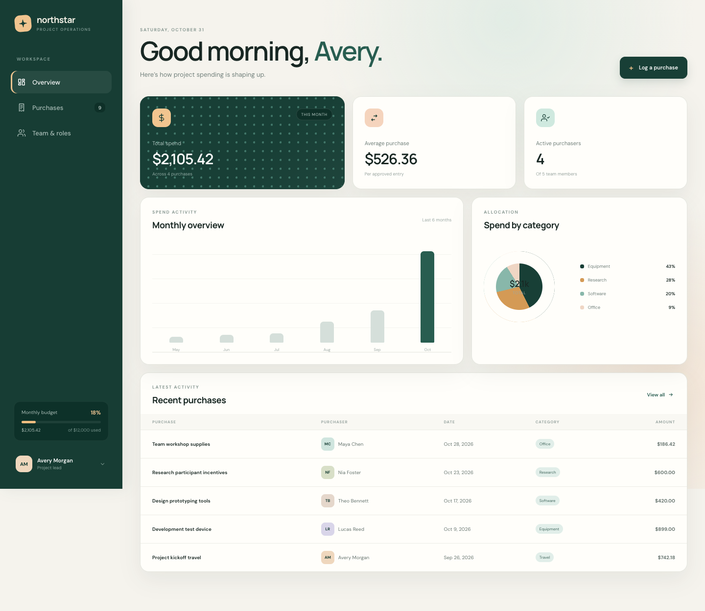

# Northstar planning site

A self-contained team purchase tracker built from the supplied planning brief.

[View the live site](https://planning-site-eight.vercel.app)



## Run locally

Run it from this folder with any static server, for example:

```sh
python3 -m http.server 4173
```

Then open `http://localhost:4173`. Data is stored in the browser's local storage.

Run the small validation test with:

```sh
node --test planning-core.test.mjs
```
